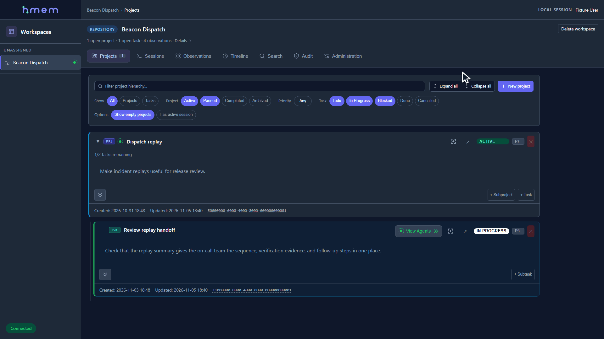

hmem stores repository observations, projects, and tasks in PostgreSQL, with a web
interface, HTTP API, and MCP tools.

## Deploy locally without sign-in

Use rootful Docker Engine 28 or later on Linux with Docker Compose 2.24.4 or
later. This setup gives local clients superadmin access without a login or token.
Use it on a trusted machine with ports 8420 and 55432 available.

1. From the repository root, copy `.env.example` to `.env` for a fresh setup.
   Set a strong `POSTGRES_PASSWORD` and update these values. Leave hmem token
   settings unset and `HMEM_CORS_ALLOWED_ORIGINS` empty.

   ```dotenv
   HMEM_ENV_FILE=.env
   HMEM_AUTH_MODE=local
   HMEM_AUTH_ENABLED=false
   HMEM_AUTH_LOCAL_BOOTSTRAP_ENABLED=true
   HMEM_AUTH_LOCAL_ALLOW_REMOTE_BOOTSTRAP=false
   ```

2. Save this as `compose.no-auth.yaml` in the repository root. Host networking
   lets hmem listen directly on loopback and serve live browser updates.

   ```yaml
   services:
     postgres:
       ports:
         - "127.0.0.1:55432:5432"
     hmem:
       network_mode: host
       ports: !reset []
       environment:
         HMEM_SERVER_HOST: "127.0.0.1"
         HMEM_DB_HOST: "127.0.0.1"
         HMEM_DB_PORT: "55432"
   ```

3. Build and start the stack, then check its status.

   ```bash
   docker compose -f compose.yaml -f compose.no-auth.yaml up --build -d
   docker compose -f compose.yaml -f compose.no-auth.yaml ps
   ```

4. When `hmem` is healthy, open [http://127.0.0.1:8420](http://127.0.0.1:8420).
   Select **+ Workspace** to create a repository workspace. Open it and copy
   the UUID from `/workspace/<workspace-uuid>` for your MCP client.

Stop the stack with `docker compose -f compose.yaml -f compose.no-auth.yaml down`.
PostgreSQL keeps application data in the `postgres-data` volume. For shared
access, use the [authenticated Docker setup](docker.md#shared-oidc-authentication).
The [Docker guide](docker.md) also covers backups and
[image and styled HTML previews](docker.md#compose-setup-with-document-previews).

## Connect an MCP client

Configure your MCP client to launch this command from the Compose project
directory as a stdio server.

```bash
docker compose -f compose.yaml -f compose.no-auth.yaml exec -T hmem hmem-entrypoint hmem-mcp --no-auth
```

If you have `hmem-mcp` installed on the host, you can connect it directly to the
local server.

```bash
hmem-mcp --server-url http://127.0.0.1:8420 --no-auth
```

After the MCP handshake, call `set_workspace` with your workspace UUID and both
identity fields.

```json
{"workspace_id":"<workspace-uuid>","identity":{"role":"Developer","model-id":"codex:gpt-6.1-sol:high"}}
```

Use your client's actual role and model identity. See
[MCP setup](hmem-mcp/README.md) for client configuration or
[Docker MCP setup](docker.md#mcp-stdio-client) for authenticated deployments.

## Walkthrough



## Native installation

<details>
<summary>Show setup for Windows or Linux</summary>

For Windows or Linux, install Haskell Stack, PostgreSQL, and a supported Node.js
LTS release (20 or later) with npm. Put `stack`, `initdb`, `pg_ctl`, `createdb`,
`psql`, and `npm` on `PATH`. Run these commands from the repository root.

```bash
stack install
stack run build-frontend -- --install
hmem-ctl
hmem-ctl start
hmem-ctl status
```

Run `stack path --local-bin` to find the executable directory and add it to `PATH`
before running `hmem-ctl`. Setup creates a local database and
`~/.hmem/config.yaml`, and registers services to start automatically. Use
`hmem-ctl init` instead of the
bare `hmem-ctl` command to manage startup yourself.

If the frontend build reports that it was skipped, install Node.js/npm and rerun
the build command. The API can run without the web interface.

Open [http://localhost:8420](http://localhost:8420). The native default allows
local access without a login. Keep it on loopback and configure
[authentication](auth.md) before enabling shared access.

From the repository you want to track, select or create its workspace.

```bash
hmem-ctl workspace
```

This writes `.hmem.workspace` in the current directory with the selected workspace
UUID. Use `hmem-ctl status` to check services and `hmem-ctl stop` to stop them.

</details>

## Optional similarity search

Full-text search works without embeddings. Add optional similarity search with
compatible vectors, or opt into GPU generation. See [embeddings](embeddings.md)
for setup and usage.

## Guides

| Topic | Guide |
| --- | --- |
| Login, permissions, and tokens | [Authentication](auth.md) |
| Using the web interface | [Web interface](hmem-server/frontend/guide.md) |
| Containers, backups, and restore | [Docker](docker.md) |
| Vectors and optional GPU setup | [Embeddings](embeddings.md) |

## References

- [API](api.md) and [MCP](hmem-mcp/reference.md)
- [Database diagram](database.md) and [schema behavior](docs/reference/schema.md)
- [Upgrades](docs/reference/upgrades.md)
- [Frontend development](hmem-server/frontend/development.md)
- [Local scratch work](docs/reference/scratch-work.md)
