```mermaid
classDiagram
  direction TB
  %% Planning
    class workspaces {
      UUID id PK
      TEXT name
      workspace_type_enum workspace_type
      TEXT? gh_owner
      TEXT? gh_repo
      TIMESTAMPTZ created_at
      TIMESTAMPTZ updated_at
      TIMESTAMPTZ? deleted_at
    }
    class projects {
      UUID id PK
      UUID workspace_id FK
      UUID? parent_id FK
      TEXT name
      TEXT? description
      project_status_enum status
      BOOLEAN own_paused
      SMALLINT priority
      JSONB metadata
      TIMESTAMPTZ created_at
      TIMESTAMPTZ updated_at
      TIMESTAMPTZ? deleted_at
      TSVECTOR search_vector
    }
    class project_retained_pause_intents {
      UUID project_id PK FK
    }
    class tasks {
      UUID id PK
      UUID workspace_id FK
      UUID? project_id FK
      UUID? parent_id FK
      TEXT title
      TEXT? description
      task_status_enum status
      SMALLINT priority
      JSONB metadata
      TIMESTAMPTZ? completed_at
      TIMESTAMPTZ created_at
      TIMESTAMPTZ updated_at
      TIMESTAMPTZ? deleted_at
      TSVECTOR search_vector
      BOOLEAN auto_blocked
    }
    class task_dependencies {
      UUID task_id PK FK
      UUID depends_on_id PK FK
      UUID workspace_id
    }
    class workspace_groups {
      UUID id PK
      TEXT name UK
      TEXT? description
      TIMESTAMPTZ created_at
      TIMESTAMPTZ updated_at
    }
    class workspace_group_members {
      UUID group_id PK FK
      UUID workspace_id PK FK
      TIMESTAMPTZ joined_at
    }
    class saved_views {
      UUID id PK
      UUID workspace_id FK
      TEXT name
      TEXT? description
      TEXT entity_type
      JSONB query_params
      TIMESTAMPTZ? deleted_at
      TIMESTAMPTZ created_at
      TIMESTAMPTZ updated_at
    }
  %% Identity
    class users {
      UUID id PK
      TEXT? auth_subject UK
      TEXT? email
      TEXT? display_name
      BOOLEAN can_create_workspace
      BOOLEAN is_superadmin
      TIMESTAMPTZ created_at
      TIMESTAMPTZ updated_at
      TIMESTAMPTZ? disabled_at
    }
    class workspace_memberships {
      UUID workspace_id PK FK
      UUID user_id PK FK
      workspace_role_enum role
      UUID? granted_by FK
      TIMESTAMPTZ created_at
      TIMESTAMPTZ updated_at
    }
    class access_tokens {
      UUID id PK
      UUID grant_user_id FK
      actor_type_enum actor_type
      TEXT actor_label
      TEXT token_hash UK
      TIMESTAMPTZ? expires_at
      TIMESTAMPTZ? revoked_at
      TIMESTAMPTZ? last_used_at
      TIMESTAMPTZ created_at
    }
    class auth_sessions {
      UUID id PK
      UUID user_id FK
      TEXT session_hash UK
      TEXT csrf_token_hash
      TIMESTAMPTZ expires_at
      TIMESTAMPTZ? revoked_at
      TIMESTAMPTZ? last_used_at
      TIMESTAMPTZ created_at
    }
  %% Agent session evidence
    class sessions {
      UUID id PK
      UUID workspace_id FK
      TEXT format_label
      TEXT? title
      UUID? parent_session_id FK
      TEXT state
      TEXT? creator_actor_type
      TEXT? creator_actor_id
      TEXT? creator_actor_label
      JSONB? creator_bot_identity
      JSONB? runtime_identity
      BIGINT runtime_revision
      TIMESTAMPTZ created_at
      TIMESTAMPTZ last_seen_at
      BIGINT committed_bytes
      BIGINT committed_records
      BIGINT revision
      BOOLEAN ends_with_newline
      TIMESTAMPTZ? terminated_at
      BIGINT? final_bytes
      TEXT? final_sha256
      UUID? import_task_id FK
      BIGINT? import_bytes
      TEXT? import_sha256
    }
    class session_chunks {
      UUID session_id PK FK
      BIGINT start_offset PK
      BIGINT revision
      BYTEA data
      BOOLEAN allow_final_record
      BIGINT record_count
      BOOLEAN ends_with_newline
    }
    class session_archive_jobs {
      UUID session_id PK FK
      UUID workspace_id FK
      TEXT state
      BIGINT attempt
      UUID? generation_id FK
      UUID? lease_token
      TIMESTAMPTZ? lease_expires_at
      TIMESTAMPTZ retry_at
      TEXT phase
      BIGINT raw_progress
      BIGINT compressed_progress
      TEXT? error_code
    }
    class session_archive_generations {
      UUID id PK
      UUID session_id FK
      UUID workspace_id FK
      BIGINT attempt
      UUID lease_token
      TEXT codec
      TEXT codec_implementation
      JSONB codec_parameters
      BIGINT raw_bytes
      BIGINT raw_records
      BIGINT raw_revision
      TEXT raw_sha256
      TIMESTAMPTZ created_at
      TIMESTAMPTZ? published_at
      BIGINT? compressed_bytes
      TEXT? compressed_sha256
      BIGINT? part_count
      BIGINT? checkpoint_count
      BIGINT? ledger_count
      TEXT? metadata_sha256
    }
    class session_archive_parts {
      UUID generation_id PK FK
      UUID session_id FK
      UUID workspace_id FK
      BIGINT ordinal PK
      BIGINT start_offset
      BIGINT end_offset
      BYTEA data
      TEXT data_sha256
      TEXT binding_sha256
    }
    class session_archive_checkpoints {
      UUID generation_id PK FK
      UUID session_id FK
      UUID workspace_id FK
      BIGINT ordinal PK
      BIGINT raw_offset
      BIGINT compressed_offset
      SMALLINT unused_bits
      BYTEA dictionary
      TEXT dictionary_sha256
      TEXT binding_sha256
    }
    class session_archive_ledger {
      UUID generation_id PK FK
      UUID session_id FK
      UUID workspace_id FK
      BIGINT revision PK
      BIGINT start_offset
      BIGINT end_offset
      BOOLEAN allow_final_record
      BIGINT record_count
      BOOLEAN ends_with_newline
      TEXT raw_sha256
      TEXT binding_sha256
    }
    class session_archive_control {
      BOOLEAN singleton PK
      TIMESTAMPTZ cutover_at
      BOOLEAN paused
      BOOLEAN backfill_enabled
      BOOLEAN reclaim_enabled
      BOOLEAN qualified
      TIMESTAMPTZ? cursor_time
      UUID? cursor_id
      BIGINT staging_budget
      BIGINT wal_budget
      BIGINT staged_bytes
      BIGINT reserved_bytes
      UUID? permit_generation
      UUID? permit_token
      TEXT? permit_kind
      TIMESTAMPTZ? permit_expires_at
      TEXT? blocked_reason
    }
    class session_archive_requests {
      UUID session_id PK FK
      UUID workspace_id FK
      TIMESTAMPTZ requested_at
    }
    class session_archive_reclamation {
      UUID generation_id PK FK
      UUID session_id FK
      UUID workspace_id FK
      TEXT metadata_sha256
      TIMESTAMPTZ? verified_at
      TIMESTAMPTZ retry_at
      BIGINT deleted_revision
      BIGINT deleted_bytes
      BOOLEAN complete
      TEXT? error_code
    }
    class task_sessions {
      UUID workspace_id FK
      UUID task_id PK FK
      UUID session_id PK FK
      TIMESTAMPTZ created_at
    }
  %% Evidence
    class observations {
      UUID id PK
      UUID workspace_id FK
      TEXT git_sha
      TEXT content
      TSVECTOR search_vector
      TIMESTAMPTZ created_at
      TIMESTAMPTZ updated_at
      BOOLEAN subject_set_open
      TEXT? embedding_space_fingerprint
      UUID content_version
      BIGINT latest_sequence
      JSONB? current_provenance
      vector1536? embedding OPTIONAL
    }
    class observation_subjects {
      UUID observation_id PK FK
      SMALLINT ordinal PK
      observation_subject_kind subject_kind
      TEXT subject
    }
    class observation_revision_events {
      UUID observation_id PK FK
      BIGINT sequence PK
      TEXT event_kind
      TEXT reviewed_git_sha
      UUID? content_version
      TEXT? content_digest
      TIMESTAMPTZ recorded_at
      TEXT? actor_type
      TEXT? actor_id
      TEXT? actor_label
      JSONB? bot_identity
    }
    class embedding_jobs {
      UUID observation_id PK FK
      UUID workspace_id FK
      TEXT content_fingerprint
      TEXT space_fingerprint
      TEXT state
      INTEGER attempts
      TIMESTAMPTZ next_attempt_at
      TEXT? lease_owner
      TIMESTAMPTZ? lease_expires_at
      TEXT? failure_code
      TIMESTAMPTZ created_at
      TIMESTAMPTZ updated_at
    }
    class embedding_target_state {
      BOOLEAN singleton PK
      BOOLEAN enabled
      TEXT? space_fingerprint
      UUID? reconcile_cursor
      TIMESTAMPTZ updated_at
    }
  %% Synchronization
    class change_stream_scope_counters {
      TEXT scope
      UUID? workspace_id
      BIGINT next_cursor
      BIGINT authorization_epoch
      BIGINT retained_from_cursor
    }
    class change_stream_outbox {
      UUID event_id PK
      TEXT scope
      UUID? workspace_id
      BIGINT cursor
      TIMESTAMPTZ occurred_at
      UUID transaction_id
      TEXT transaction_cause
      TEXT? request_id
      TEXT actor_type
      TEXT? actor_id
      JSONB envelope
    }
    class change_stream_resume_tokens {
      BYTEA token_hash PK
      TEXT scope
      UUID? workspace_id
      TEXT audience_kind
      TEXT audience_key
      UUID? audience_user_id
      BIGINT authorization_epoch
      BIGINT watermark
      TIMESTAMPTZ expires_at
      TIMESTAMPTZ? superseded_at
      BYTEA? session_hash
      TIMESTAMPTZ created_at
    }
    class change_stream_snapshot_sessions {
      BYTEA session_hash PK
      TEXT scope
      UUID? workspace_id
      TEXT audience_kind
      TEXT audience_key
      UUID? audience_user_id
      BIGINT authorization_epoch
      BIGINT high_watermark
      TIMESTAMPTZ expires_at
      TIMESTAMPTZ? terminal_at
      BYTEA? resume_token_hash
      BYTEA page_token_hash
      BYTEA? terminal_page_token_hash
      BIGINT next_ordinal
      TIMESTAMPTZ created_at
      INTEGER? page_size
      BYTEA? start_idempotency_hash
      TEXT snapshot_profile
    }
    class change_stream_snapshot_items {
      BYTEA session_hash PK FK
      BIGINT ordinal PK
      JSONB item
    }
    class change_stream_snapshot_page_tokens {
      BYTEA token_hash PK
      BYTEA session_hash FK
      BIGINT start_ordinal
      BIGINT? end_ordinal
      BOOLEAN terminal
    }
  %% Administration
    class schema_migrations {
      INTEGER version PK
      TEXT name
      TIMESTAMPTZ applied_at
    }
    class audit_log {
      UUID id PK
      TEXT entity_type
      TEXT entity_id
      audit_action_enum action
      JSONB? old_values
      JSONB? new_values
      TEXT? request_id
      TIMESTAMPTZ changed_at
      UUID? workspace_id
      actor_type_enum? actor_type
      TEXT? actor_id
      TEXT? actor_label
      JSONB? bot_identity
    }
    class task_flatten_migration_report {
      UUID id PK
      UUID? task_id FK
      TEXT issue
      JSONB detail
      TIMESTAMPTZ created_at
    }
    class delete_cascade_migration_report {
      UUID id PK
      TEXT entity_type
      UUID entity_id
      TEXT issue
      JSONB detail
      TIMESTAMPTZ created_at
    }

  workspaces "1" --> "0..*" projects : workspace_id
  projects "0..1" --> "0..*" projects : parent_id
  projects "1" --> "0..1" project_retained_pause_intents : project_id
  workspaces "1" --> "0..*" tasks : workspace_id
  projects "0..1" --> "0..*" tasks : project_id SET NULL
  tasks "0..1" --> "0..*" tasks : parent_id
  tasks "1" --> "0..*" task_dependencies : task_id
  tasks "1" --> "0..*" task_dependencies : depends_on_id
  workspace_groups "1" --> "0..*" workspace_group_members : group_id
  workspaces "1" --> "0..*" workspace_group_members : workspace_id
  workspaces "1" --> "0..*" saved_views : workspace_id NO ACTION
  workspaces "1" --> "0..*" workspace_memberships : workspace_id
  users "1" --> "0..*" workspace_memberships : user_id
  users "0..1" --> "0..*" workspace_memberships : granted_by SET NULL
  users "1" --> "0..*" access_tokens : grant_user_id
  users "1" --> "0..*" auth_sessions : user_id
  workspaces "1" --> "0..*" sessions : workspace_id NO ACTION
  sessions "1" --> "0..*" session_chunks : session_id NO ACTION
  sessions "1" --> "0..1" session_archive_jobs : id + workspace_id NO ACTION
  session_archive_jobs "1" --> "0..*" session_archive_generations : session_id + workspace_id NO ACTION
  session_archive_generations "0..1" <-- "0..1" session_archive_jobs : generation_id + session_id + workspace_id NO ACTION
  session_archive_generations "1" --> "0..*" session_archive_parts : id + session_id + workspace_id NO ACTION
  session_archive_generations "1" --> "0..*" session_archive_checkpoints : id + session_id + workspace_id NO ACTION
  session_archive_generations "1" --> "0..*" session_archive_ledger : id + session_id + workspace_id NO ACTION
  sessions "1" --> "0..1" session_archive_requests : id + workspace_id NO ACTION
  session_archive_generations "1" --> "0..1" session_archive_reclamation : id + session_id + workspace_id NO ACTION
  sessions "1" --> "0..*" task_sessions : id + workspace_id NO ACTION
  tasks "1" --> "0..*" task_sessions : id + workspace_id NO ACTION
  tasks "0..1" --> "0..*" sessions : import_task_id, workspace_id NO ACTION
  workspaces "1" --> "0..*" observations : workspace_id
  observations "1" --> "0..*" observation_subjects : observation_id
  observations "1" --> "0..*" observation_revision_events : observation_id
  observations "1" --> "0..1" embedding_jobs : observation_id + workspace_id
  workspaces "1" --> "0..*" embedding_jobs : workspace_id
  change_stream_snapshot_sessions "1" --> "0..*" change_stream_snapshot_items : session_hash
  change_stream_snapshot_sessions "1" --> "0..*" change_stream_snapshot_page_tokens : session_hash
  tasks "0..1" --> "0..*" task_flatten_migration_report : task_id

  note "PK = primary key; UK = unique key; FK = foreign key\n? = nullable; all other columns NOT NULL\nRepeated PK marks a composite key\nLines show declared foreign keys only\nON DELETE CASCADE unless a line says otherwise"
  note for workspaces "UNIQUE (gh_owner, gh_repo)\nWHERE both are non-null AND deleted_at IS NULL"
  note for observations "UNIQUE (id, workspace_id)\nembedding: vector(1536), nullable; present only with pgvector enabled"
  note for sessions "UNIQUE (id, workspace_id)\nLive rows require a same-transaction in_progress task link; imports require their declared historical task\nOptional same-workspace parent fixed at creation\nNew titles: 1–80 UTF-8 bytes; legacy title NULL\nstate: active or terminated; sealed metadata immutable"
  sessions "0..1" --> "0..*" sessions : parent_session_id, workspace_id
  note for session_chunks "UNIQUE (session_id, revision)\n1 to 1048576 raw bytes; immutable ordered append\nV051 verified maintenance may reclaim complete raw rows"
  note for session_archive_jobs "UNIQUE (session_id, workspace_id)\nState: queued, running, retry, ready, failed\nCurrent-generation FK deferred until commit"
  note for session_archive_generations "UNIQUE (id, session_id, workspace_id) and (session_id, attempt)\nOne published generation per session\nPublication fields are all NULL until publication"
  note for session_archive_parts "UNIQUE (generation_id, start_offset)\nAt most 1 MiB EXTERNAL payload; ordered hash chain"
  note for session_archive_checkpoints "UNIQUE (generation_id, raw_offset)\nAt most 32 KiB EXTENDED dictionary; at most 1 MiB raw gap"
  note for session_archive_ledger "UNIQUE (generation_id, start_offset)\nExact original append metadata and chunk SHA-256"
  note for session_archive_control "One initialized true singleton\nCapacity values are logical policy, not measured free disk/WAL caps\nPermit IDs are control fields without foreign keys"
  note for session_archive_reclamation "Mutable verification/progress bound to immutable manifest\nRaw deletion at most 8 rows / 8 MiB per transaction"
  note for tasks "UNIQUE (id, workspace_id), used by session links"
  note for task_sessions "Composite foreign keys enforce one workspace\nAdditive links survive task soft deletion"
  note for observation_subjects "UNIQUE (observation_id, subject_kind, subject)"
  note for change_stream_scope_counters "UNIQUE (scope, coalesce(workspace_id, zero UUID))"
  note for change_stream_outbox "UNIQUE (scope, workspace_id, cursor)\nAlso UNIQUE with workspace_id coalesced to zero UUID"
  note for change_stream_snapshot_sessions "UNIQUE start binding when start_idempotency_hash is non-null:\nscope, coalesce(workspace_id, zero UUID), audience_kind,\naudience_key, coalesce(audience_user_id, zero UUID), start_idempotency_hash"
  note for task_flatten_migration_report "UNIQUE (task_id, issue)"
  note for delete_cascade_migration_report "UNIQUE (entity_type, entity_id, issue)"
```

V042 adds session metadata and association audit/outbox triggers without changing
these tables or relationships. `agent_session` audit values use an explicit
metadata allowlist; `task_session` identity is `session_id:task_id`. Each row
transition emits one attributed workspace event in its transaction. Metadata
updates have two fixed invalidations, links four; neither scans linked tasks.
`session_chunks` remains outside audit, outbox and snapshot materialization.
Existing snapshot items, versions and retained bearers are unchanged. See the
[schema reference](docs/reference/schema.md#agent-session-change-delivery-v042).

V043 adds nullable `sessions.title` and `parent_session_id` without rewriting
legacy evidence. New inserts require a trimmed nonblank title of at most 80 UTF-8
bytes and an existing same-workspace parent when supplied. Title and parent are
immutable; the composite parent FK and prospective guard prevent foreign,
self/cyclic or later parent changes. Existing task links remain additive;
new links lock the task row and require `in_progress`. Historical links survive
later status transitions. See the [schema reference](docs/reference/schema.md#session-tree-and-titles-v043).

V044 adds nullable `sessions.runtime_identity` and nonnegative, non-null
`runtime_revision` (default 0). Runtime is an explicit declaration about the
target model, separate from immutable `creator_*` connection attribution. Legacy
runtime remains unknown. Active declarations use an isolated revision-guarded
update without changing transcript cursors, bytes/hash or heartbeat activity;
sealed metadata remains immutable. See the [schema reference](docs/reference/schema.md#session-runtime-identity-v044).

V045 adds an insert-only deferred constraint trigger: each new session must have
at least one live same-workspace `in_progress` task association at transaction
completion by default, or when the transaction explicitly requests an immediate
creation check. The existing task-link guard holds its task lock through commit.
Historical orphans are retained; later task completion/deletion and session
append/heartbeat/sealing remain independent. The guard and migration ledger
commit atomically. See the [schema reference](docs/reference/schema.md#initial-session-task-v045).

V046 adds an optional stored runtime `role` (1–128 trimmed UTF-8 bytes) and a
prospective guard requiring it on new nonnull runtime declarations. Existing
roleless values and evidence are preserved; unrelated lifecycle writes and
resume remain valid. See the [schema reference](docs/reference/schema.md#session-runtime-roles-v046).

V047 adds the partial active-session `(last_seen_at, id)` index for bounded,
server-owned cleanup. Sessions idle for more than one hour are sealed only when
every explicit linked task is done or cancelled (including soft-deleted rows);
legacy sessions with no links also qualify. The server hashes the committed
prefix without an exclusive session lock, then rechecks unchanged activity,
transcript cursor and terminal task statuses under locks before storing the
immutable receipt. See the [schema reference](docs/reference/schema.md#idle-session-cleanup-v047).

V049 adds the nullable historical import tuple `import_task_id`, `import_bytes`
and `import_sha256`. All three are null for live captures, or present with a
nonnegative byte count and lowercase SHA-256 for imports. The composite task
foreign key enforces the workspace. The tuple is immutable, limits appended
bytes, and requires every seal to match the complete declared size/hash.
Import runtime identity is fixed at registration. The deferred initial-link guard
accepts the declared nondeleted historical task in any status; other new links
retain the live `in_progress` rule. Pending imports are excluded from live
activity, navigation predicates and abandoned-session sealing.

V050 stores one verified whole-stream gzip in bounded archive parts, with
immutable checkpoint dictionaries and the original append ledger. V051 adds
separate durable controls, explicit on-demand requests and manifest-bound
verification/reclamation progress. Its narrow maintenance capability may delete
verified raw chunks while retaining the sealed receipt, archive and ledger;
ordinary evidence mutation stays forbidden. Historical discovery and raw
reclamation default off. See the [archive reference](docs/reference/sealed-session-archives.md)
and [ordered upgrade procedure](docs/reference/upgrades.md#sealed-archive-maintenance-v050-and-v051).
